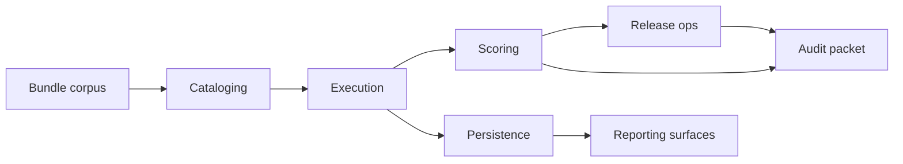

# Architecture

PixelForge Imaging Control Plane is a file-first internal system for running PixelForge certification lanes, scoring nightly regressions, and freezing release evidence in a way that can be replayed months later. The package layout follows the handoffs the imaging team uses during a release week. If a workflow has a different owner in real life, it gets a different boundary in code.

The checked-in corpus mixes codec, transform, compositing, partner-export, and reliability-heavy lanes because the certification program grew from one shared operations rail. That history matters. It is why the repo leans on reusable policy, storage, and reporting modules instead of one-off scripts for a single PNG decoder lane.

## Runtime shape

The product has five primary paths:

1. Catalog load: bundle metadata and case rows are loaded from `tests/fixtures/catalog` or another checked-in corpus.
2. Execution: a replay payload is matched against bundle cases and converted into stable case results.
3. Scoring: case results are weighted into public, hidden, and section-level conformance signals.
4. Release and audit: a release manifest is assembled, then an audit packet is written with deterministic content ordering.
5. Persistence and reporting: run history is written into SQLite snapshots, then read back into dashboard and owner review surfaces.

The top-level CLI is deliberately thin. `src/pixelforge_ops/cli.py` does argument parsing and delegates to package functions so the same workflows can be exercised directly from tests without spawning a subprocess for every command.

## Package boundaries

### `cataloging`

This package owns bundle discovery, metadata joins, owner playbooks, lineage, and workflow contracts. A bundle is treated as a release artifact, not as a one-off regression script. Validation helpers care about ownership, release notes, case coverage, compatibility lanes, and sign-off expectations, not only whether JSON loads.

### `execution` and `execution_engine`

`execution.py` evaluates a single replay into `SubmissionRun`. `execution_engine` handles policy around comparators, batch queue shape, status matrices, runtime budgets, retry planning, and transcript generation. The split keeps the core scoring input small while still giving operators richer diagnostics when a decode, transform, or compositing run is slow, noisy, or only partially comparable.

### `scoring` and `scoring_model`

These modules own score math, flag generation, fairness checks, thresholding, and band assignment. The important product decision here is that public and hidden performance stay separate all the way through reporting. Imaging teams care whether visible PNG smoke tests stay green, but they also care whether hidden alpha-edge, color-drift, or large-raster regressions are creeping upward underneath.

### `release_ops`

Release logic covers manifests, digests, readiness, rollout gates, owner capacity, and launch calendars. This code is intentionally opinionated because imaging release problems are often policy problems with technical symptoms. The gate logic should explain why a lane is blocked, which owner is constrained, and what capacity is still open in the current train.

### `auditpack`

Audit packet code freezes evidence into deterministic artifacts. Contracts, field dictionaries, packet traces, retention rules, and evidence validation all live here. The archive format is stable by design so repeated exports from identical inputs hash the same way. That matters when a rollout decision is challenged after a bad nightly, a color-management regression, or a partner compatibility incident.

### `persistence` and `reporting_surfaces`

Persistence owns SQLite migrations, query catalogs, snapshot inspection, schema drift checks, and retention planning. Reporting surfaces are read-only projections over scorecards and stored history. That keeps dashboard changes from mutating the audit path.

## Data flow

The same `SubmissionRun` and `Scorecard` objects show up across release, audit, and storage. That shared model makes regressions obvious. If a score moves, we can compare the raw replay, the section math, the release decision, and the archived evidence without converting between incompatible shapes.

## Failure isolation

We separate failures into the buckets the team actually triages:

- Catalog failures: missing metadata, duplicate cases, workflow contract gaps
- Execution failures: timeouts, comparator mismatches, missing results, runtime errors
- Scoring failures: threshold changes, public-hidden gaps, section drift
- Release failures: capacity exhaustion, blackout windows, missing readiness checks
- Audit failures: incomplete evidence, manifest drift, inconsistent trace content
- Persistence failures: missing tables, schema drift, retention-rule violations

That split matters because the fix path is different for each class. A comparator mismatch in a JPEG fidelity lane should not page the same owner as a release blackout violation in a partner export lane.

## Why the repo leans on fixtures

The history corpus and SQLite snapshots are intentionally large because the product is supposed to operate on realistic certification volume. Those fixtures are not decorative. They back schema drift checks, owner rollups, retention plans, risk summaries, and release trend analysis. The surrounding source needs to earn that weight, which is why the repo carries deeper query, validation, and reporting modules instead of a tiny demo script.
