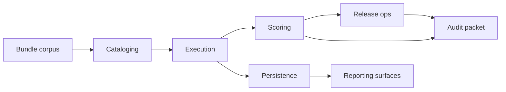

# Architecture

Engineering Challenge Control Plane is a file-first internal tool for running curated challenge bundles, scoring participant submissions, and freezing release evidence in a way that is easy to replay later. The codebase is split around the same handoffs the operations team uses during a release week. That is the main design rule. If a workflow has a separate owner in real life, it also gets a separate boundary in code.

The current corpus mixes finance, platform, routing, and data-review bundles because that is how the internal program grew. The same runtime model also supports the department lanes described in [department-guides.md](./department-guides.md), which is why the code favors reusable policy and reporting modules over one-off per-bundle scripts.

## Runtime shape

The product has five primary paths:

1. Catalog load: bundle metadata and case rows are loaded from `tests/fixtures/catalog` or a checked-in corpus.
2. Execution: an attempt payload is matched against bundle cases and converted into stable case results.
3. Scoring: case results are weighted into public, hidden, and section-level score signals.
4. Release and audit: a release manifest is assembled, then an audit packet is written with deterministic content ordering.
5. Persistence and reporting: run history is written into SQLite snapshots, then read back into dashboard and owner-review surfaces.

The top-level CLI is deliberately thin. `src/engineering_challenge/cli.py` does argument parsing and delegates to package functions so the same workflows can be exercised directly from tests without spawning a subprocess for every command.

## Package boundaries

### `cataloging`

This package owns bundle discovery, metadata joins, review playbooks, lineage, and workflow contracts. A bundle is treated as a release artifact rather than a toy exercise. Validation helpers care about ownership, release notes, case coverage, and review expectations, not only whether JSON loads.

### `execution` and `execution_engine`

`execution.py` evaluates a single attempt into `SubmissionRun`. `execution_engine` handles policy around comparators, batch queue shape, status matrices, runtime budgets, retry planning, and transcript generation. The split keeps the core scoring input small while still giving operators richer diagnostics when a run is slow or noisy.

### `scoring` and `scoring_model`

These modules own score math, flag generation, fairness checks, thresholding, and band assignment. The important product decision here is that public and hidden performance stay separate all the way through reporting. The workbench does not flatten them into one number until an operator explicitly asks for a blended view.

### `release_ops`

Release logic covers manifests, digests, readiness, rollout gates, owner capacity, and launch calendars. This code is intentionally opinionated because release issues are usually policy problems with technical symptoms. The gate logic should explain why a bundle is blocked, which owner is constrained, and what capacity is left in the current train.

### `auditpack`

Audit packet code freezes evidence into deterministic artifacts. Contracts, field dictionaries, packet traces, retention rules, and evidence validation all live here. The archive format is stable by design so repeated exports from identical inputs hash the same way.

### `persistence` and `reporting_surfaces`

Persistence owns SQLite migrations, query catalogs, snapshot inspection, schema drift checks, and retention planning. Reporting surfaces are read-only projections over scorecards and stored history. That keeps dashboard changes from mutating the audit path.

## Data flow

The same `SubmissionRun` and `Scorecard` objects show up across release, audit, and storage. That shared model makes regressions obvious. If a score moves, we can compare the raw run, the section math, the release decision, and the archived evidence without converting between five incompatible shapes.

## Failure isolation

We separate failures into the buckets the team actually triages:

- Catalog failures: missing metadata, duplicate cases, workflow contract gaps
- Execution failures: timeouts, comparator mismatches, missing results, runtime errors
- Scoring failures: threshold changes, public-hidden gaps, section drift
- Release failures: capacity exhaustion, blackout windows, missing readiness checks
- Audit failures: incomplete evidence, manifest drift, inconsistent trace content
- Persistence failures: missing tables, schema drift, retention-rule violations

That split matters because the fix path is different for each class. A failed comparator should not page the same owner as a release blackout violation.

## Why the repo leans on fixtures

The history corpus and SQLite snapshots are intentionally large because the product is supposed to operate on realistic review volume. Those fixtures are not decorative. They back schema drift checks, owner rollups, retention plans, risk summaries, and release trend analysis. The surrounding source needs to earn that weight, which is why the repo carries deeper query, validation, and reporting modules instead of a tiny demo script.
